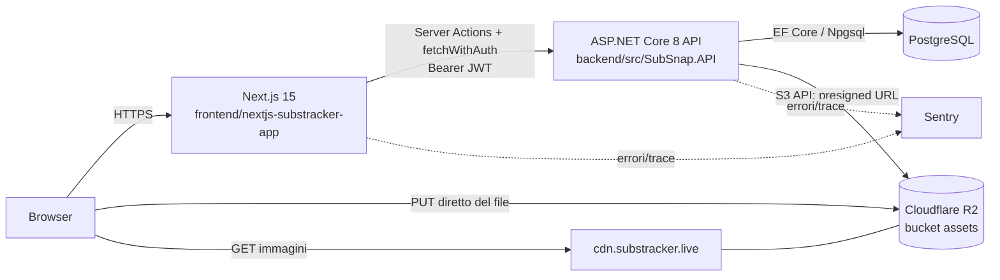
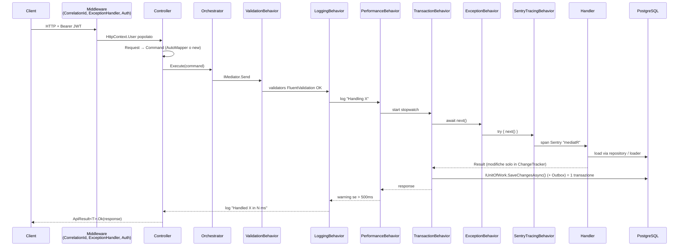
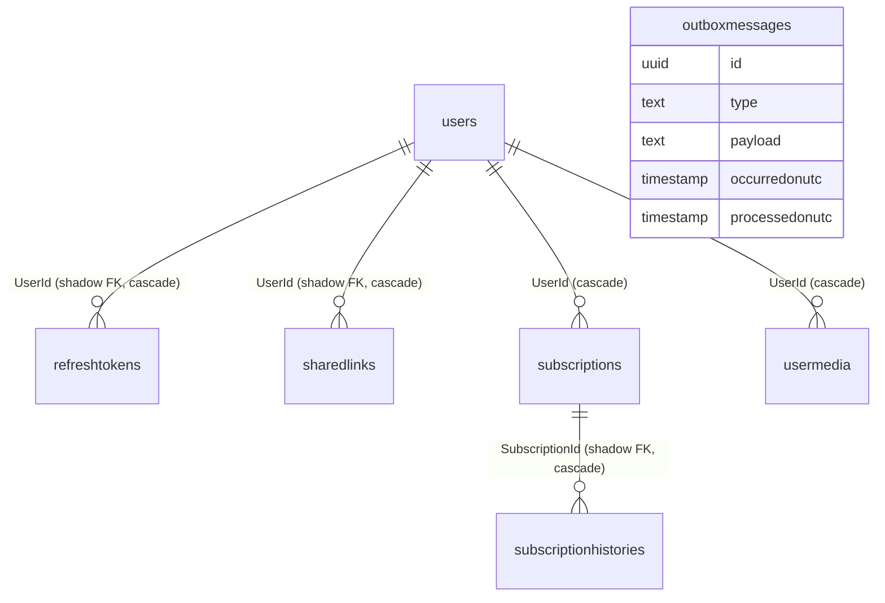
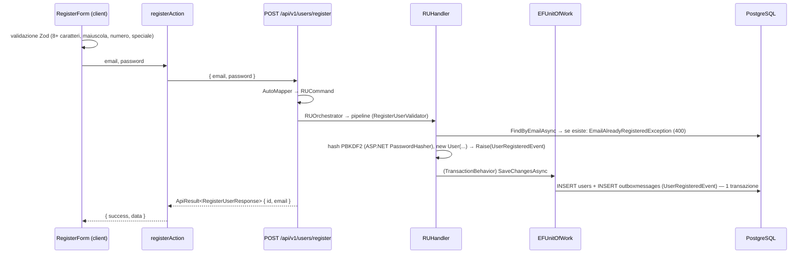
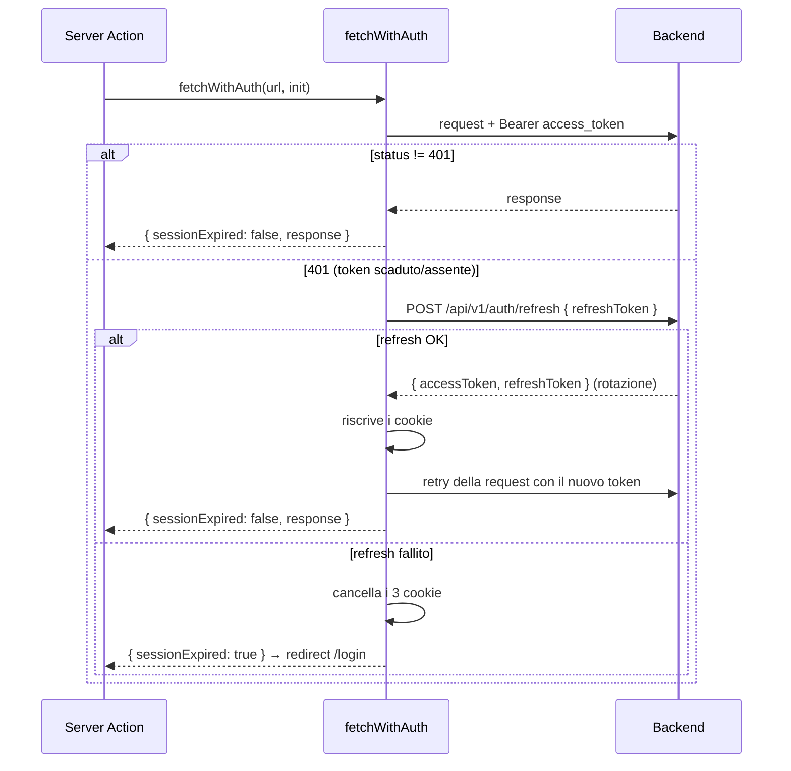
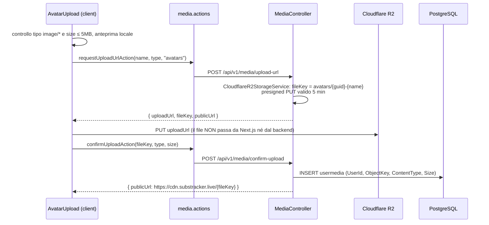
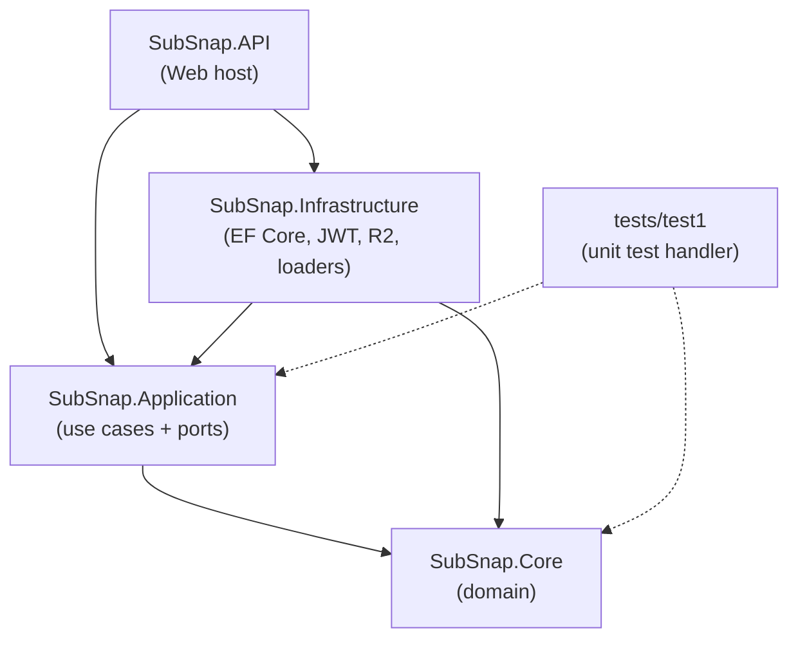

# SubSnap / substracker.live — ARCHITECTURE

Questo documento spiega **come funziona l'intera piattaforma** (frontend, backend, database, servizi esterni) e descrive **tutti i flows** end-to-end, file per file.
Per la filosofia dei pattern (DDD, CQRS, Outbox, ecc.) vedi anche `README.md`; qui l'obiettivo è mostrare *cosa succede davvero* quando arriva una richiesta.


flow di INGRESSO (Request → Business)  //lo leggi dall'alto verso il basso
HTTP Request
  ↓
Controller (API)
  └─ Riceve Request DTO esterno (External Request DTO)
  └─ Suppress automatic ModelState validation ([ApiController] + SuppressModelStateInvalidFilter)
  ↓
FluentValidation (API-only)
  └─ Validator centralizzato tramite ValidatorHelper (o non usato direttamente w IValidator<T>)
  └─ Se invalido, lancia ValidationException
  ↓
ExceptionMiddleware (intercetta ValidationException)
  └─ Trasforma in ApiResult.Fail(ApiError)
  └─ (non continua al Service Layer se fallisce)
  ↓
AutoMapper (Request DTO → Application Command)
  └─ Mappa DTO di ingresso al Command dell’Application Layer
  ↓
Application Service (Use Case / UserService)
  └─ Controlli di business (ad es. email già registrata)
  └─ Se errore di dominio, lancia DomainException
  ↓
Domain Layer
   ├─ Entities (User, Subscription, etc.)
   ├─ Value Objects (UserId, Email, PasswordHash, etc.)
   ├─ Aggregates (UserAggregate)
   └─ Domain Exceptions (EmailAlreadyRegisteredException, NotFoundException, etc.)
  ↓
Repository Interfaces (Core.Contracts)
  └─ Definiscono contratti senza dipendenze EF
  ↓
Infrastructure Repositories (EF Core)
  └─ Implementano le query verso DbContext
  ↓
Unit of Work (EF SaveChanges)
  └─ Commit delle modifiche in transazione
  ↓
DbContext (EF Core)
  └─ Interazione reale con il database
  ↓
SQL Server


flow di USCITA (Business → Response)  //lo leggi dal basso verso l'alto
SQL Server
  ↑
DbContext (EF Core)
  ↑
Infrastructure Repositories
  ↑
Application Service (Use Case)
     └─ Restituisce Result DTO (UserResult, ecc.)
  ↑
AutoMapper (Application Result DTO → Response DTO)
     └─ Mapping solo DTO, mai Domain → EF
  ↑
ApiResult<T>.Ok(Response DTO)
     └─ Success = true, Data = Response DTO
  ↑
Controller (API)
     └─ Restituisce HTTP 200 + body in formato ApiResult<T>
  ↑
HTTP Response


flow when ERROR (override totale)  //lo leggi dal bassso verso l'alto 
Qualsiasi Exception (EF / Infrastructure / Domain / Application)
  ↑
DomainException / ValidationException / SystemException
     └─ Ad esempio: EmailAlreadyRegisteredException, NotFoundException, FluentValidation.ValidationException🔥
  ↑
Global ExceptionMiddleware (API)
     └─ Intercetta tutte le eccezioni
     └─ Mappa in ApiError
  ↑
ApiResult<T>.Fail(ApiError)
     └─ Success = false
     └─ StatusCode coerente (400, 404, 500, ecc.)
  ↑
Controller / Middleware pipeline
     └─ HTTP Response
         └─ StatusCode coerente (400, 404, 500, ecc.)
         └─ Body standardizzato: ApiResult<T>

Core → nessun plugin ( no FluentValidation, AutoMapper, EF, Newtonsoft, ect).
Infrastructure → EF base + logging opzionale.
API → AutoMapper per DTO ↔ DTO, FluentValidation, Middleware, Auth, Swagger.

Il Controller orchestra, non decide
Il Domain decide, non conosce HTTP
Infrastructure esegue, non pensa
API formatta, non valida business


---

## 1. Panoramica del sistema



| Componente | Tecnologia | Cartella |
|---|---|---|
| Frontend principale | Next.js 15 (App Router, Server Actions, middleware edge), React 19, Tailwind 4, next-intl, Zod, Recharts, Motion | `frontend/nextjs-substracker-app/` |
| Frontend secondario (prototipo) | Vite + React 19, Redux Toolkit, React Query, React Router | `frontend/reactpp-app-subsnap/` — non usato in produzione, solo scheletro auth |
| Backend | ASP.NET Core 8, MediatR, FluentValidation, AutoMapper, EF Core (Npgsql), Scrutor | `backend/src/` |
| Database | PostgreSQL (estensione `pgcrypto`) | schema in fondo a `README.md`, migrations: `TOKNOW.md` |
| Storage media | Cloudflare R2 (S3-compatible) + CDN `cdn.substracker.live` | `SubSnap.Infrastructure/External/Storage/` |
| Osservabilità | Sentry (backend + Next.js server/edge/client), log con CorrelationId | — |
| Deploy | Docker (backend: `backend/Dockerfile`, porta 8080; frontend: `frontend/nextjs-substracker-app/Dockerfile`, output standalone) — variabili d'ambiente gestite in Coolify | — |

---

## 2. Backend — struttura a layer

```
            SubSnap.API              (HTTP, controllers, middleware, startup)
           /            \
SubSnap.Application   SubSnap.Infrastructure   (use cases + ports | implementazioni)
           \            /
            SubSnap.Core             (domain: entities, value objects, events, exceptions)
```

| Layer | Responsabilità | Dipende da |
|---|---|---|
| **Core** (`SubSnap.Core/Domain`) | Entities (`User`, `Subscription`, `RefreshToken`, `SharedLink`, `SubscriptionHistory`, `UserMedia`), Value Objects `readonly struct` (`UserId`, `Email`, `PasswordHash`, `SubscriptionId`, …), `AggregateRoot` con domain events, eccezioni di dominio, aggregate di lettura (`*Aggregate.cs`) | nessuno (solo MediatR per `INotification`) |
| **Application** (`SubSnap.Application`) | Use cases a *vertical slice* (`UseCases/<Area>/<Slice>/` con Command, Handler, Orchestrator, Result, Loaders, Policies), pipeline behaviors MediatR, validators FluentValidation, **Ports** (interfacce) | Core |
| **Infrastructure** (`SubSnap.Infrastructure`) | `ApplicationDbContext` + configurazioni EF, repositories, `EFUnitOfWork` (+ Outbox), JWT, password hasher, DataLoaders (aggregate/batch/projection), `QueryCache`, R2 storage, `SentryTracingBehavior`, `OutboxProcessor` | Application, Core |
| **API** (`SubSnap.API`) | Controllers v1, Contracts (Request/Response, `ApiResult`, `ApiError`), mapping AutoMapper, middleware (CorrelationId, exception handler), startup extensions | Application, Infrastructure |

### 2.1 Composition root (`SubSnap.API/Program.cs`)

Ordine di registrazione dei servizi:
1. `UseSentry` (DSN da `Sentry:Dsn`, 20% tracing, no PII).
2. Controllers + `AddValidationConfiguration` (disattiva il ModelState automatico: la validazione è tutta FluentValidation nella pipeline).
3. CORS (`Cors:AllowedOrigins`), Swagger, JWT Bearer authentication, policy `UserOnly`, health checks.
4. AutoMapper (profili in `SubSnap.API/Mapping`).
5. `AddApplication()` → MediatR, validators, scan Scrutor di tutte le classi `*Policy`, `*Loader`, `*Orchestrator` (scoped), behaviors.
6. `AddInfrastructure()` → DbContext + DbContextFactory (retry on failure x5), repositories, UoW, JWT/hasher, loaders, `QueryCache`, client S3 R2 (singleton), `CloudflareR2StorageService`, `SentryTracingBehavior`.

Pipeline HTTP (middleware, in ordine):

```
UseCorrelationId → UseGlobalExceptionHandler → UseSentryTracing → Swagger → CORS
→ UseAuthentication → UseAuthorization → /health → MapControllers
```

Endpoint tecnici: `GET /` ("API OK"), `GET /health`, `GET /health/db` (prova la connessione al DB), `/swagger`.

### 2.2 Il percorso di una richiesta (flow generico)

Ogni use case segue lo stesso schema "a cipolla":



Punti chiave:
- **Il controller non conosce MediatR**: inietta solo gli `*Orchestrator` (wrapper sottili su `IMediator.Send`).
- **Ordine dei behaviors** = ordine di registrazione: Validation → Logging → Performance → Transaction → Exception (in `Application/DependencyInjection`) → SentryTracing (registrato per ultimo in Infrastructure, quindi è il più interno).
- **Nessun handler chiama `SaveChanges`**: lo fa solo `TransactionBehavior` dopo `next()`. Viene eseguito anche per le query (è un no-op se il ChangeTracker è vuoto).
- **Envelope uniforme**: ogni risposta è `{ success, data, error: { statusCode, message } }` (`Contracts/Responses/ApiResult.cs`).

### 2.3 Flow degli errori

```
Handler / Value Object / Validator lancia eccezione
  → ExceptionBehavior: DomainException = LogWarning, altro = LogError, poi rethrow
  → UseGlobalExceptionHandler (Middleware/ExceptionHandling/ExceptionMiddlewareExtensions.cs)
      NotFoundException            → 404
      DomainException              → 400  (es. EmailAlreadyRegisteredException)
      ValidationException          → 400  (FluentValidation)
      ArgumentException            → 400  (costruttori VO: Email, UserId…)
      UnauthorizedAccessException  → 401
      altro                        → 500 + SentrySdk.CaptureException
  → ApiResult.Fail(ApiError) in JSON
```

Solo i 500 vengono inviati a Sentry: errori di dominio/validazione sono "attesi".

### 2.4 Correlation ID e logging

`CorrelationIdMiddleware` legge `X-Correlation-Id` dalla richiesta (o ne genera uno), lo rimanda nella response e apre uno scope di log: ogni log della richiesta (behaviors, batch loader) contiene `CorrelationId`. `SubscriptionBatchLoader` lo recupera via `IHttpContextAccessor` perché esegue la query su un task in background.

---

## 3. Modello di dominio e database



| Aggregate root | Figli (modificabili solo tramite la root) | Repository |
|---|---|---|
| `User` | `RefreshToken` (lista privata `_refreshTokens`), `SharedLink` (`_sharedLinks`) | `IUserRepository` → `UserRepository` |
| `Subscription` | `SubscriptionHistory` (tabella separata, FK shadow `SubscriptionId`) | `ISubscriptionRepository` → `SubscriptionRepository` |
| `UserMedia` | — | `IUserMediaRepository` → `UserMediaRepository` |

Regole:
- Gli aggregate root si referenziano **solo per Id** (`Subscription.UserId`), mai con navigation property.
- Gli Id sono generati nel dominio (`UserId.New()` ecc.), quindi non serve un `SaveChanges` per conoscere l'Id.
- `Email` è normalizzata lowercase e validata via regex nel costruttore.
- Il mapping EF è in `Infrastructure/Persistence/Configurations/*Configuration.cs` (tabelle lowercase: `users`, `refreshtokens`, `sharedlinks`, `subscriptions`, `subscriptionhistories`, `usermedia`, `outboxmessages`).

### 3.1 Modelli di lettura (CQRS lato read)

| Strumento | File | Quando |
|---|---|---|
| **Repository** (tracked) | `Repositories/Implementations/*` | Comandi che modificano dati |
| **AggregateLoader** | `DataLoaders/Aggregates/*` | Root + figli con query **parallele** (un `DbContext` per query via `IDbContextFactory`, `Task.WhenAll`, `AsNoTracking`), niente `.Include()`; risultato in `QueryCache` |
| **BatchLoader** | `DataLoaders/Batch/SubscriptionBatchLoader.cs` | Stile GraphQL DataLoader: le chiamate `Load(userId)` arrivate entro 5 ms vengono raggruppate in una sola `SELECT … WHERE userid IN (…)` |
| **ProjectionLoader** | `DataLoaders/Projections/*` | Combinano più aggregate (es. user + subscriptions) per un singolo caso d'uso; le *View* restano in Infrastructure. Pronti ma non ancora collegati a un endpoint |
| **QueryCache** | `Caching/QueryCache.cs` | Cache scoped alla singola richiesta HTTP |

---

## 4. Frontend Next.js — struttura

```
Browser
  → src/middleware.ts (edge): rilevamento locale + gate auth basato su cookie
  → app/[locale]/layout.tsx: NextIntlClientProvider
  → (auth)/login, (auth)/register          pagine pubbliche
  → (dashboard)/layout.tsx: secondo controllo token + AuthProvider + Navbar + avatar
      → dashboard/page.tsx (Server Component): carica le subscriptions
      → profile/page.tsx
  → Client Components (features/*): form, modali, grafici
        ↕
  src/shared/actions/*.actions.ts ("use server"): leggono i cookie httpOnly, chiamano il backend
        ↕
  ASP.NET Core API (NEXT_PUBLIC_API_URL, default http://localhost:5000)
```

- **Tutte le chiamate al backend passano da Server Actions** (`auth`, `subscription`, `user`, `media`): il browser non vede mai i JWT.
- Endpoint centralizzati in `src/config/index.ts` (`API_ENDPOINTS`, `COOKIE_NAMES`, `ROUTES`).
- `fetchWithAuth` (`src/shared/utils/fetchWithAuth.ts`) aggiunge `Authorization: Bearer`, gestisce il refresh automatico su 401 e restituisce `{ sessionExpired }`; l'action chiamante fa `redirect(ROUTES.login)` quando la sessione è scaduta.
- Dopo una mutazione il client chiama `router.refresh()` (in `startTransition`) per rieseguire i Server Components.

### 4.1 Cookie di sessione

| Cookie | httpOnly | Durata | Uso |
|---|---|---|---|
| `access_token` | sì | 10 min (= `JwtSettings:AccessTokenExpiryMinutes`) | Bearer verso l'API, gate del middleware |
| `refresh_token` | sì | 30 giorni (= `RefreshTokenExpiryDays`) | Rinnovo token |
| `user_info` | no | 10 min | `{ id, email }` per la UI (Navbar, saluto) |
| `theme` | no | 365 giorni | Dark mode lato SSR (`getServerTheme`) |
| `NEXT_LOCALE` | no | gestito da next-intl | Lingua scelta |

---

## 5. Tutti i flows

### 5.1 Navigazione, i18n e gate di autenticazione

File: `src/middleware.ts`, `src/i18n/routing.ts`.

1. Il middleware gira su tutte le rotte tranne `api`, `_next/*`, `favicon.ico`, `sitemap.xml`, `robots.txt`.
2. **Locale**: cookie `NEXT_LOCALE` → header Cloudflare `CF-IPCountry` (`IT` → `it`, altrimenti `en`) → `Accept-Language` → default `en`. Prefisso `as-needed`: inglese senza prefisso, italiano su `/it/...`.
3. **Auth gate** (controlla solo la *presenza* del cookie `access_token`):
   - rotta protetta (`/dashboard`, `/profile`) senza token → redirect a `/login?from=<path>`;
   - `/login` o `/register` con token → redirect a `/dashboard`.
4. La locale rilevata viene scritta in `Accept-Language` e la richiesta passa a `next-intl`.
5. `(dashboard)/layout.tsx` ricontrolla il token lato server (secondo livello), legge `user_info`, carica l'avatar (`getMyAvatarAction`) e monta `AuthProvider`.

### 5.2 Registrazione



Dopo la registrazione l'utente esegue il login (la registrazione non crea una sessione).

### 5.3 Login

1. `LoginForm` → `loginAction(email, password)`.
2. `POST /api/v1/auth/login` → `LoginRequestAuth` → AutoMapper → `LoginCommand(Email, Password)` (il VO `Email` valida il formato: errore = 400).
3. `LoginHandler`:
   - `UserByEmailLoader` → utente oppure `UnauthorizedAccessException` (401);
   - `PasswordPolicy.EnsureValid` verifica l'hash;
   - `JwtTokenService.GenerateAccessToken` (claims `sub`, `nameidentifier`, `email`; HMAC-SHA256; scadenza 10 min);
   - refresh token = 64 byte casuali in Base64; nel DB viene salvato **solo l'hash** (`user.AddRefreshToken(hash, expiry)`).
4. `TransactionBehavior` salva il nuovo `refreshtokens`.
5. Response `{ accessToken, refreshToken }` (il refresh token in chiaro arriva solo al client).
6. La Server Action imposta i cookie `access_token` e `refresh_token`, poi chiama `GET /api/v1/users/me` per ottenere l'id e imposta `user_info`.
7. Il client naviga su `/dashboard`.

### 5.4 Richiesta autenticata + refresh automatico



Lato backend (`RTHandler`), con **rotazione** del refresh token:
1. `IUserRepository.FindByRefreshTokenAsync` trova l'utente che possiede il token (confronto con l'hash).
2. `user.FindActiveRefreshToken(matcher)` → token non revocato e non scaduto, altrimenti 401.
3. Il vecchio token viene revocato, ne viene emesso uno nuovo (hash salvato) insieme a un nuovo access token.

### 5.5 Logout

1. `AuthContext.logout()` → `logoutAction()`.
2. Se c'è un refresh token: `fetchWithAuth(POST /api/v1/auth/logout, { refreshToken })` (passa da fetchWithAuth così, se l'access token è scaduto, viene prima rinnovato e la revoca va a buon fine).
3. Backend `[Authorize]`: `UserId` dal claim `sub`/`nameidentifier` → `LogoutCommand` → `LogoutHandler` → `LogoutTokenPolicy` trova il token attivo corrispondente → `user.RevokeRefreshToken` → salvato da `TransactionBehavior`. Risposta `204`.
4. Il frontend cancella i 3 cookie e fa redirect a `/login` (anche se la chiamata API fallisce).

### 5.6 Dashboard: lettura delle subscriptions

1. `dashboard/page.tsx` (Server Component) → `getSubscriptionsAction()` → `GET /api/v1/subscriptions`.
2. `SubscriptionsController` → `GetUserSubsOrchestrator` → `GetUserSubsHandler` → `ISubscriptionBatchLoader.Load(userId)`:
   - la richiesta viene messa in `_pending` (un `TaskCompletionSource` per utente);
   - dopo 5 ms un'unica query `WHERE userid IN (…)` serve tutte le richieste in attesa;
   - il risultato viene ordinato per `CreatedAt` desc.
3. La pagina calcola le statistiche (`computeStats`: conteggio, costo mensile e annuale normalizzati per ciclo di fatturazione) e passa l'array a:
   - `StatsGrid` (3 card),
   - `ChartsSection` → `SpendingTrendChart`, `CategoryBreakdownChart`, `BillingCycleChart`, `TopSubscriptionsChart` (tutti calcolati lato client da `subscriptionUtils.toMonthly`),
   - `SubscriptionList` (stato client inizializzato con i dati del server).

### 5.7 Dettaglio subscription (con storico)

`GET /api/v1/subscriptions/{id}` → `GetSubDetailHandler` → `SubscriptionAggregateLoader.LoadWithSubscriptionHistoriesAsync`:
- 2 query parallele su 2 `DbContext` (subscription e histories), `AsNoTracking`, risultato in `QueryCache`;
- `SubscriptionNotFoundException` (404) se non esiste, 401 se `UserId` non coincide (controllo di ownership);
- risposta con lo storico ordinato dal più recente.
Dal frontend è esposto con `getSubscriptionDetailAction`.

### 5.8 Creazione / modifica / eliminazione subscription

```
SubscriptionList (client)
  → SubscriptionFormModal (react-hook-form + Zod) / DeleteConfirmDialog
  → create/update/deleteSubscriptionAction → fetchWithAuth
  → POST | PUT /{id} | DELETE /{id} /api/v1/subscriptions
  → se la risposta è OK: aggiorna lo stato locale con i dati restituiti + router.refresh()
```

| Operazione | Handler | Cosa fa | Risposta |
|---|---|---|---|
| Create | `CreateSubHandler` (validator `CreateSubCommandValidator`) | `new Subscription(...)` + `SubscriptionHistory("Created", null, "nome \| importo \| ciclo")` | `201 Created` + `Location` |
| Update | `UpdateSubHandler` (validator `UpdateSubCommandValidator`) | carica, controlla ownership (401), salva snapshot vecchio, `sub.Update(...)`, history `"Updated"` (old → new) | `200` |
| Delete | `DeleteSubHandler` | carica, controlla ownership, cancella le histories, poi la subscription | `204` |

Tutte le scritture vengono committate insieme da `TransactionBehavior` (subscription + history nella stessa transazione).

### 5.9 Profilo utente

| Azione UI | Server Action | Endpoint | Handler |
|---|---|---|---|
| Visualizza profilo (`ProfileInfo`) | `getProfileAction` | `GET /api/v1/users/me` | `GetUserProfileHandler` → id, email, isActive, createdAt, updatedAt, lastLogin |
| Cambia email (`ChangeEmailForm`) | `updateProfileAction({ newEmail })` | `PUT /api/v1/users/me` | `UpdateUserProfileHandler`: controlla che l'email non sia già usata da un altro utente → `user.UpdateEmail` |
| Cambia password (`ChangePasswordForm`) | `updateProfileAction({ currentPassword, newPassword })` | `PUT /api/v1/users/me` | verifica la password attuale (401 se errata) → nuovo hash → `user.UpdatePassword` |
| Elimina account (`DeleteAccountSection`) | `deleteUserAction` | `DELETE /api/v1/users/me` | `DeleteUserHandler` → `UserRepository.DeleteAsync`; il cascade sul DB elimina refresh tokens, shared links, subscriptions (+ histories) e usermedia. `204` |

Validazione: `UpdateUserProfileCommandValidator` (almeno uno tra email e password; la password nuova richiede quella attuale).

### 5.10 Upload avatar (presigned URL su Cloudflare R2)



- Lettura: `GET /api/v1/media` restituisce gli URL CDN dei media dell'utente; `(dashboard)/layout.tsx` usa il primo come avatar nella Navbar.
- Il dominio CDN è autorizzato in `next.config.ts` (`images.remotePatterns`).
- Nota: `MediaController` usa direttamente repository + `IUnitOfWork` (non passa da Orchestrator/MediatR), quindi niente behaviors di validazione/logging su questi endpoint.

### 5.11 Domain events e Outbox

```
new User(...) → AggregateRoot.Raise(UserRegisteredEvent)    (solo in memoria)
TransactionBehavior → EFUnitOfWork.SaveChangesAsync():
    1. raccoglie i DomainEvents da tutte le entità AggregateRoot nel ChangeTracker
    2. ClearDomainEvents()
    3. ogni evento → OutboxMessage { Type = AssemblyQualifiedName, Payload = JSON }
    4. SaveChanges → entità + outbox nella stessa transazione
OutboxProcessor (BackgroundService):
    SELECT … FROM outboxmessages WHERE processedonutc IS NULL
    ORDER BY occurredonutc FOR UPDATE SKIP LOCKED LIMIT 20
    → deserializza → IMediator.Publish → INotificationHandler (es. UserRegisteredHandler: log)
    → ProcessedOnUtc = now, commit
```

**Stato attuale**: la registrazione `services.AddHostedService<OutboxProcessor>()` è **commentata** in `ServiceCollectionExtensions.cs`, quindi i messaggi vengono scritti in `outboxmessages` ma non sono consumati. Anche quando è attivo, il processor ha tempi molto lunghi (24h di attesa all'avvio, poi 1h di polling). L'unico handler esistente (`UserRegisteredHandler`) scrive solo un log; è il punto dove agganciare, per esempio, l'email di benvenuto.

### 5.12 Osservabilità (Sentry)

| Dove | Cosa |
|---|---|
| Backend `Program.cs` | `UseSentry` + `UseSentryTracing`: ogni richiesta HTTP diventa una transaction |
| `SentryTracingBehavior` | span figlio `mediatR: <CommandName>` attorno al solo handler |
| `CloudflareR2StorageService` | span `r2.upload` / `r2.delete` |
| Exception handler / `OutboxProcessor` | `CaptureException` per 500 ed errori del worker |
| Frontend | `sentry.server.config.ts`, `sentry.edge.config.ts`, `instrumentation-client.ts`; `instrumentation.ts` → `onRequestError`; `global-error.tsx` cattura gli errori React |

### 5.13 Tema, SEO e altro (solo frontend)

- **Dark mode**: `getServerTheme()` legge il cookie `theme` e renderizza `<html class="dark">` già in SSR; `useDarkMode()` lo cambia lato client.
- **SEO**: `app/sitemap.ts` (route pubbliche × 2 lingue con hreflang), `app/robots.ts` (disallow `/dashboard`, `/profile`, `/api/`), `manifest.json`.
- **Traduzioni**: `messages/en.json`, `messages/it.json`, caricate da `src/i18n/request.ts`.

---

## 6. Mappa completa degli endpoint API (v1)

| Metodo | Route | Auth | Orchestrator / handler | Usato da (frontend) |
|---|---|---|---|---|
| POST | `/api/v1/users/register` | — | `RUOrchestrator` | `registerAction` |
| POST | `/api/v1/auth/login` | — | `LoginOrchestrator` | `loginAction` |
| POST | `/api/v1/auth/refresh` | — | `RTOrchestrator` | `fetchWithAuth` |
| POST | `/api/v1/auth/logout` | JWT | `LogoutOrchestrator` | `logoutAction` |
| GET | `/api/v1/users/me` | JWT | `GetUserProfileOrchestrator` | `loginAction`, `getProfileAction` |
| PUT | `/api/v1/users/me` | JWT | `UpdateUserProfileOrchestrator` | `updateProfileAction` |
| DELETE | `/api/v1/users/me` | JWT | `DeleteUserOrchestrator` | `deleteUserAction` |
| GET | `/api/v1/subscriptions` | JWT | `GetUserSubsOrchestrator` | `getSubscriptionsAction` |
| GET | `/api/v1/subscriptions/{id}` | JWT | `GetSubDetailOrchestrator` | `getSubscriptionDetailAction` |
| POST | `/api/v1/subscriptions` | JWT | `CreateSubOrchestrator` | `createSubscriptionAction` |
| PUT | `/api/v1/subscriptions/{id}` | JWT | `UpdateSubOrchestrator` | `updateSubscriptionAction` |
| DELETE | `/api/v1/subscriptions/{id}` | JWT | `DeleteSubOrchestrator` | `deleteSubscriptionAction` |
| POST | `/api/v1/media/upload-url` | JWT | `IObjectStorageService` (diretto) | `requestUploadUrlAction` |
| POST | `/api/v1/media/confirm-upload` | JWT | `IUserMediaRepository` + `IUnitOfWork` (diretto) | `confirmUploadAction` |
| GET | `/api/v1/media` | JWT | `IUserMediaRepository` (diretto) | `getMyAvatarAction` |

Lo slice `UseCases/Users/GetUsersWithSubscriptions` (GUS) esiste come riferimento per il batch loader ma il suo handler è commentato e non ha un endpoint.

---

## 7. Configurazione

### Backend (`appsettings.*.json` / variabili d'ambiente con `__`)

| Chiave | Uso |
|---|---|
| `ConnectionStrings:sqlConnection` | PostgreSQL |
| `JwtSettings:Issuer`, `Audience`, `SecretKey` | firma e validazione dei JWT (`ClockSkew = 0`) |
| `JwtSettings:AccessTokenExpiryMinutes` (10), `RefreshTokenExpiryDays` (30) | durate dei token, allineate ai cookie del frontend |
| `CloudflareR2:AccountId`, `BucketName`, `AccessKey`, `SecretKey`, `CdnBaseUrl` | storage media |
| `Cors:AllowedOrigins` | origini del frontend |
| `Sentry:Dsn` | vuoto in locale = Sentry disattivato |

In produzione i segreti arrivano dalle variabili d'ambiente (Coolify), es. `JwtSettings__SecretKey`, `CloudflareR2__AccessKey`.

### Frontend

| Variabile | Default |
|---|---|
| `NEXT_PUBLIC_API_URL` | `http://localhost:5000` |
| `NEXT_PUBLIC_SITE_URL` | `https://substracker.live` |
| `SENTRY_AUTH_TOKEN` | upload delle source map in fase di build |

---

## 8. Test

`backend/tests/test1`: unit test degli handler (`CreateSubHandlerTests`, `UpdateSubHandlerTests`, `DeleteSubHandlerTests`, `UpdateUserProfileHandlerTests`). Gli handler dipendono solo dai Ports, quindi si testano con dei mock, senza DB né HTTP.

---

## 9. Come aggiungere un nuovo use case (checklist)

1. **Core**: eventuale metodo di dominio sull'aggregate root (mai modificare i figli dall'esterno).
2. **Application**: `UseCases/<Area>/<Nome>/` con `XCommand : IRequest<XResult>`, `XHandler`, `XOrchestrator` (registrato in automatico dal suffisso), `XResult`; eventuale `Validators/XCommandValidator`; eventuali nuovi Ports.
3. **Infrastructure**: implementazione dei nuovi Ports + registrazione in `ServiceCollectionExtensions`.
4. **API**: Request/Response in `Contracts/`, mapping in `Mapping/*Profile.cs`, action nel controller che chiama l'orchestrator e restituisce `ApiResult<T>`.
5. **Frontend**: endpoint in `src/config/index.ts`, Server Action in `src/shared/actions/` tramite `fetchWithAuth`, tipi in `src/shared/types/`, componente in `src/features/<area>/`.

---

## 10. Punti di attenzione noti

- **Outbox disattivato** (vedi 5.11): gli eventi vengono accumulati senza essere pubblicati.
- **Gate del middleware solo sul cookie `access_token` (10 min)**: quando il cookie scade, il middleware reindirizza a `/login` prima che `fetchWithAuth` possa usare il refresh token. In pratica la sessione UI dura 10 minuti di inattività, anche se il refresh token è valido per 30 giorni.
- **`UserRepository.FindByRefreshTokenAsync`** chiama `IPasswordHasherService.Verify` dentro un predicato LINQ di EF Core: questa espressione non è traducibile in SQL, quindi conviene verificare a runtime che il refresh (`POST /auth/refresh`) funzioni davvero (alternativa: hash deterministico, es. SHA-256, cercato per uguaglianza).
- I controller ripetono `GetCurrentUserId()`; `Controllers/Base/ApiControllerBase.cs` è vuoto e potrebbe ospitarlo.
- I file `*_OLDbutdontdelete.cs` e `DTOsOLDNOWISIN.Application_dontdeletebackup/` sono backup non usati.
- `frontend/reactpp-app-subsnap` è un prototipo alternativo (Vite + Redux) non collegato al deploy.

---

## 11. Struttura a cartelle del backend

### 11.1 Dipendenze tra i progetti



### 11.2 Albero delle cartelle

Esclusi `bin/` e `obj/`. In `UseCases/` ogni cartella è una *vertical slice* con lo stesso schema (`XCommand`, `XHandler`, `XOrchestrator`, `XResult`, più eventuali `Loaders/` e `Policies/`); per brevità i file sono mostrati solo per `Login` e `CreateSubscription`.

```
backend/
├── Dockerfile                          # immagine del backend (porta 8080)
├── .dockerignore
├── src/
│   ├── SubSnap.API/                    # ── LAYER API (HTTP) ──────────────────────────────
│   │   ├── Program.cs                  # composition root + pipeline middleware
│   │   ├── appsettings*.json           # Development / Staging / Production
│   │   ├── Properties/launchSettings.json
│   │   ├── Controllers/
│   │   │   ├── Base/ApiControllerBase.cs        # vuoto
│   │   │   └── V1/
│   │   │       ├── AuthController.cs            # login, refresh, logout
│   │   │       ├── UsersController.cs           # register, me (GET/PUT/DELETE)
│   │   │       ├── SubscriptionsController.cs   # CRUD subscriptions
│   │   │       └── MediaController.cs           # upload-url, confirm-upload, lista media
│   │   ├── Contracts/                  # DTO HTTP (Request/Response) + envelope
│   │   │   ├── Auth/{Requests,Responses}/
│   │   │   ├── Users/{Requests,Responses}/
│   │   │   ├── Subscriptions/{Requests,Responses}/
│   │   │   ├── Media/{Requests,Responses}/
│   │   │   ├── Responses/ApiResult.cs
│   │   │   └── Errors/ApiError.cs
│   │   ├── Mapping/
│   │   │   ├── RequestToCommandProfile.cs       # Request → Command
│   │   │   └── ResultToResponseProfile.cs       # Result  → Response
│   │   ├── Middleware/
│   │   │   ├── Correlation/CorrelationIdMiddleware.cs
│   │   │   └── ExceptionHandling/ExceptionMiddlewareExtensions.cs   # eccezione → status code
│   │   ├── StartupExtensions/          # un file di estensione per ogni concern
│   │   │   ├── Authentication/  ├── Authorization/  ├── CorrelationId/
│   │   │   ├── Cors/            ├── HealthChecks/   ├── Swagger/
│   │   │   └── Validation/
│   │   └── Versioning/ApiVersioningExtensions.cs
│   │
│   ├── SubSnap.Application/            # ── LAYER APPLICATION (use cases) ─────────────────
│   │   ├── DependencyInjection/DependencyInjection.cs   # MediatR, validators, Scrutor, behaviors
│   │   ├── Common/
│   │   │   ├── Behaviors/              # Validation → Logging → Performance → Transaction → Exception
│   │   │   ├── Execution/              # IOrchestrator, IUseCaseHandler, UseCaseResult
│   │   │   └── Exceptions/ApplicationException.cs
│   │   ├── Ports/                      # interfacce implementate in Infrastructure
│   │   │   ├── Auth/                   # IJwtTokenService, IPasswordHasherService
│   │   │   ├── Persistence/            # IUserRepository, ISubscriptionRepository, IUserMediaRepository, IUnitOfWork
│   │   │   ├── DataLoadersorQueries/   # ISubscriptionAggregateLoader, ISubscriptionBatchLoader, IUserAggregateLoader
│   │   │   ├── Storage/IObjectStorageService.cs
│   │   │   └── Messaging/              # IEventDispatcher_OLDbutdontdelete (backup)
│   │   ├── Validators/                 # FluentValidation: Login, RegisterUser, CreateSub, UpdateSub, UpdateUserProfile
│   │   └── UseCases/
│   │       ├── Auth/
│   │       │   ├── Login/
│   │       │   │   ├── LoginCommand.cs
│   │       │   │   ├── LoginHandler.cs
│   │       │   │   ├── LoginOrchestrator.cs
│   │       │   │   ├── LoginResult.cs
│   │       │   │   ├── Loaders/UserByEmailLoader.cs
│   │       │   │   └── Policies/PasswordPolicy.cs
│   │       │   ├── Logout/             # + Loaders/, Policies/LogoutTokenPolicy
│   │       │   └── RefreshToken/       # RT* (rotazione refresh token)
│   │       ├── Users/
│   │       │   ├── RegisterUser/       # RU*
│   │       │   ├── GetUserProfile/
│   │       │   ├── UpdateUserProfile/
│   │       │   ├── DeleteUser/         # + Loaders/
│   │       │   └── GetUsersWithSubscriptions/   # GUS* (handler commentato, nessun endpoint)
│   │       └── Subscriptions/
│   │           ├── CreateSubscription/
│   │           │   ├── CreateSubCommand.cs
│   │           │   ├── CreateSubHandler.cs
│   │           │   ├── CreateSubOrchestrator.cs
│   │           │   └── CreateSubResult.cs
│   │           ├── UpdateSubscription/
│   │           ├── DeleteSubscription/
│   │           ├── GetSubscriptionDetail/
│   │           └── GetUserSubscriptions/
│   │
│   ├── SubSnap.Infrastructure/         # ── LAYER INFRASTRUCTURE (implementazioni) ────────
│   │   ├── DependencyInjection/ServiceCollectionExtensions.cs   # AddInfrastructure()
│   │   ├── Persistence/
│   │   │   ├── Context/ApplicationDbContext.cs
│   │   │   ├── Configurations/         # mapping EF: User, RefreshToken, SharedLink, Subscription,
│   │   │   │                           #             SubscriptionHistory, UserMedia, OutboxMessage
│   │   │   ├── UnitOfWork/EFUnitOfWork.cs       # SaveChanges + domain events → Outbox
│   │   │   └── Outbox/OutboxMessage.cs
│   │   ├── Repositories/Implementations/        # UserRepository, SubscriptionRepository, UserMediaRepository
│   │   ├── DataLoaders/
│   │   │   ├── Aggregates/             # SubscriptionAggregateLoader, UserAggregateLoader (query parallele)
│   │   │   ├── Batch/                  # SubscriptionBatchLoader, SharedLinkBatchLoader (finestra 5 ms)
│   │   │   └── Projections/            # *ProjectionLoader + Views/*ProjectionView
│   │   ├── Caching/QueryCache.cs       # cache per-request
│   │   ├── Identity/Services/          # JwtTokenService, AspNetPasswordHasherService
│   │   ├── External/Storage/           # CloudflareR2StorageService (in uso), HetznerObjectStorageService
│   │   ├── Pipeline/SentryTracingBehavior.cs    # behavior MediatR più interno
│   │   ├── Background/OutboxProcessor.cs        # BackgroundService (registrazione commentata)
│   │   ├── Mapping/                    # *Mapper_OLDbutdontdelete.cs (backup)
│   │   └── Messaging/                  # MediatREventDispatcher_OLDbutdontdelete.cs (backup)
│   │
│   └── SubSnap.Core/                   # ── LAYER DOMAIN (nessuna dipendenza) ─────────────
│       ├── AssemblyInfo.cs
│       ├── Domain/
│       │   ├── Common/                 # AggregateRoot, IDomainEvent
│       │   ├── Entities/               # User, RefreshToken, SharedLink, Subscription,
│       │   │                           # SubscriptionHistory, UserMedia
│       │   ├── ValueObjects/           # UserId, Email, PasswordHash, SubscriptionId, SubscriptionHistoryId,
│       │   │                           # RefreshTokenId, SharedLinkId, UserMediaId
│       │   ├── Aggregates/             # modelli di lettura: UserAggregate, UserFullAggregate,
│       │   │                           # UserSubscriptionsAggregate, SubscriptionAggregate, …
│       │   ├── Events/Users/           # UserRegisteredEvent + UserRegisteredHandler
│       │   └── Exceptions/             # DomainException, NotFoundException, EmailAlreadyRegisteredException
│       └── DTOsOLDNOWISIN.Application_dontdeletebackup/   # backup non usato
│
└── tests/
    └── test1/                          # xUnit, handler testati con mock dei Ports
        ├── Subscriptions/              # CreateSub / UpdateSub / DeleteSub HandlerTests
        └── Users/                      # UpdateUserProfileHandlerTests
```
